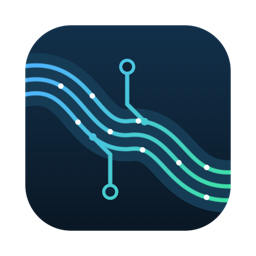
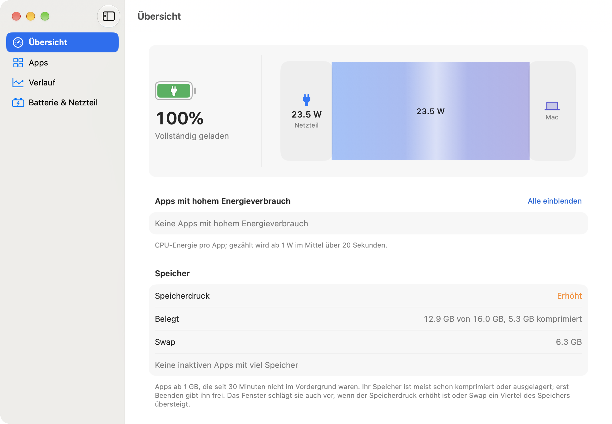

<p align="center">
  
</p>

<h1 align="center">Rill</h1>

<p align="center">
  <a href="https://github.com/chengffei/rill/releases/latest"><b>Laden</b></a> ·
  <a href="https://chengffei.github.io/rill/de/">Website</a>
</p>

<p align="center">
  <a href="README.md">English</a> ·
  <a href="README.zh-Hans.md">简体中文</a> ·
  <a href="README.zh-Hant.md">繁體中文</a> ·
  <a href="README.ja.md">日本語</a> ·
  <a href="README.ko.md">한국어</a> ·
  <a href="README.fr.md">Français</a> ·
  <b>Deutsch</b> ·
  <a href="README.es.md">Español</a>
</p>

<p align="center">
  
</p>

Eine App für die macOS-Menüleiste, die live zeigt, wohin die Energie deines Mac fließt: was das Netzteil liefert, was der Mac verbraucht, was in die Batterie hinein- oder aus ihr herausfließt und welche Apps am meisten Energie verbrauchen.

> **Status: früh (0.9).** Erfordert macOS 26 oder neuer auf einem Mac mit Apple Chip. Oberfläche auf English, 简体中文, 繁體中文, 日本語, 한국어, Français, Deutsch und Español.

## Installation

**Eine Zeile im Terminal** (empfohlen):

```sh
curl -fsSL https://raw.githubusercontent.com/chengffei/rill/main/install.sh | bash
```

Das [Skript](install.sh) lädt die neueste Version, prüft SHA-256, Codesignatur, Bundle-ID und Entwicklerteam und legt Rill in „Programme“ ab. So geladene Dateien werden nicht unter Quarantäne gestellt, daher öffnet macOS Rill ohne Warnung.

**Oder lade das Disk-Image** aus der [neuesten Version](https://github.com/chengffei/rill/releases/latest) und ziehe Rill in „Programme“. Rill ist signiert, aber nicht notarisiert, daher blockiert macOS den ersten Start: Öffne die App, schließe die Warnung und klicke dann in *Systemeinstellungen › Datenschutz & Sicherheit* auf **Dennoch öffnen**.

Wenn das Batteriesymbol nicht erscheint, ist deine Menüleiste voll oder ein Menüleisten-Manager hat es ausgeblendet.

## Was es zeigt

- **Menüleiste**: Ladestand, Ladestatus und optional die Live-Leistung in Watt (bei angeschlossenem Netzteil dessen Eingang, sonst die Batterieentladung).
- **Panel** (Symbol anklicken): ein Energieflussdiagramm vom Netzteil und der Batterie zum Mac; belegter Speicher, Speicherdruck und Swap; Apps mit hohem Energieverbrauch; bei knappem Speicher inaktive Apps, die 1 GB oder mehr belegen; ein 10-Minuten-Leistungsdiagramm; Messwerte von Netzteil und Batterie.
- **Fenster** (Dashboard öffnen): vier Seiten.
  - *Übersicht*: Ladestand, Energiefluss, energiehungrige Apps, Speicher mit inaktiven Apps, die sich zu beenden lohnen, heutiger Verbrauch.
  - *Apps*: eine sortierbare Tabelle mit Energie, CPU und Speicher pro App oder pro Prozess. Beende eine App oder beende sie sofort, beende ihren aktivsten Prozess oder finde Apps, die nicht reagieren.
  - *Verlauf*: Leistung, Ladestand und Temperatur über 1 Stunde bis 7 Tage.
  - *Batterie & Netzteil*: Zustand, Ladezyklen, Kapazität, Nennleistung des Netzteils und ausgehandelte Spannung.

Die Leistung wird alle 2 Sekunden aus dem SMC gelesen; Netzteildetails und Kapazität stammen aus der AppleSmartBattery-Registry. Die Energie pro App kommt aus `proc_pid_rusage` und wird wie in der Aktivitätsanzeige nach verantwortlicher App gruppiert. Besondere Berechtigungen sind nicht nötig.

Der Verlauf wird 30 Tage lang in `~/Library/Application Support/Rill/history` gespeichert. Rill geht nur online, wenn du **Nach Updates suchen …** wählst.

## Feedback

Wähle **Problem melden …** im Menü von Rill. Dadurch wird ein neues GitHub-Issue geöffnet, in dem deine Rill-Version, macOS-Version und dein Mac-Modell bereits eingetragen sind. Oder [erstelle hier eins](https://github.com/chengffei/rill/issues/new).

## Kompilieren

```sh
scripts/bundle.sh --install     # builds build/Rill.app, installs it in /Applications and launches it
swift test                      # needs Xcode's toolchain: DEVELOPER_DIR=/Applications/Xcode.app/Contents/Developer
scripts/make-release.sh         # dmg, zip and checksums in dist/
```

## Lizenz

Rill steht unter der [GPL-3.0](LICENSE). Beiträge setzen die Zustimmung zur [CLA](CLA.md) voraus, um die dich bei deinem ersten Pull Request ein Bot bittet.
