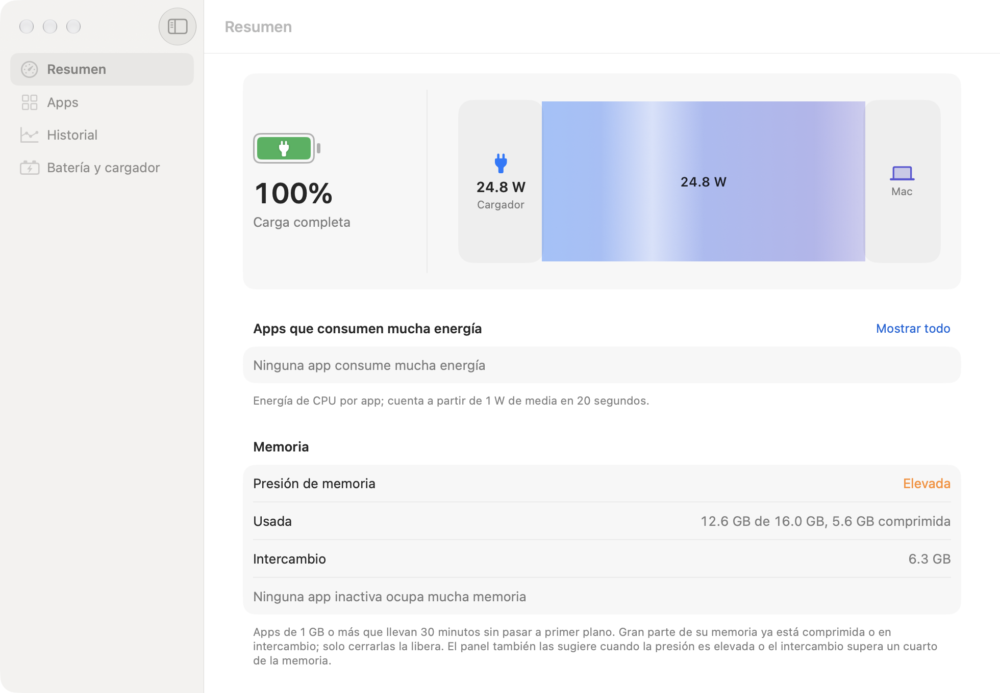

<p align="center">
  
</p>

<h1 align="center">Rill</h1>

<p align="center">
  <a href="https://github.com/chengffei/rill/releases/latest"><b>Descargar</b></a> ·
  <a href="https://chengffei.github.io/rill/es/">Sitio web</a>
</p>

<p align="center">
  <a href="README.md">English</a> ·
  <a href="README.zh-Hans.md">简体中文</a> ·
  <a href="README.zh-Hant.md">繁體中文</a> ·
  <a href="README.ja.md">日本語</a> ·
  <a href="README.ko.md">한국어</a> ·
  <a href="README.fr.md">Français</a> ·
  <a href="README.de.md">Deutsch</a> ·
  <b>Español</b>
</p>

<p align="center">
  
</p>

Una app para la barra de menús de macOS que muestra en directo adónde va la energía de tu Mac: lo que entrega el cargador, lo que consume el Mac, lo que entra en la batería o sale de ella, y qué apps consumen más energía.

> **Estado: fase inicial (0.8).** Requiere macOS 26 o posterior en un Mac con chip de Apple. Interfaz en English, 简体中文, 繁體中文, 日本語, 한국어, Français, Deutsch y Español.

## Instalación

**Una línea en Terminal** (recomendado):

```sh
curl -fsSL https://raw.githubusercontent.com/chengffei/rill/main/install.sh | bash
```

El [script](install.sh) descarga la última versión, comprueba su SHA-256, su firma de código, su ID de paquete y su equipo de desarrollo, y coloca Rill en Aplicaciones. Los archivos descargados así no quedan en cuarentena, por lo que macOS abre Rill sin mostrar ningún aviso.

**O descarga la imagen de disco** desde la [última versión](https://github.com/chengffei/rill/releases/latest) y arrastra Rill a Aplicaciones. Rill está firmado pero no notarizado, así que macOS bloquea el primer arranque: ábrelo, cierra el aviso y haz clic en **Abrir igualmente** en *Ajustes del Sistema › Privacidad y seguridad*.

Si el icono de la batería no aparece, tu barra de menús está llena o un gestor de la barra de menús lo ha ocultado.

## Qué muestra

- **Barra de menús**: nivel de batería, estado de carga y, opcionalmente, la potencia en directo en vatios (entrada del cargador si está conectado; si no, descarga de la batería).
- **Panel** (haz clic en el icono): un diagrama del flujo de energía del cargador y la batería al Mac; memoria usada, presión e intercambio; apps que consumen mucha energía; cuando falta memoria, las apps inactivas que ocupan 1 GB o más; un gráfico de potencia de 10 minutos; lecturas del cargador y la batería.
- **Ventana** (Abrir panel): cuatro páginas.
  - *Resumen*: carga, flujo de energía, apps que más energía gastan, memoria con las apps inactivas que conviene cerrar y el uso de hoy.
  - *Apps*: una tabla ordenable de energía, CPU y memoria por app o por proceso. Sal de una app o fuerza su salida, termina su proceso más activo o detecta las apps que no responden.
  - *Historial*: potencia, carga y temperatura de 1 hora a 7 días.
  - *Batería y cargador*: estado, número de ciclos, capacidad, potencia nominal del cargador y tensión negociada.

La potencia se lee del SMC cada 2 segundos; los detalles del cargador y la capacidad proceden del registro AppleSmartBattery. La energía por app procede de `proc_pid_rusage`, agrupada por app responsable como hace Monitor de Actividad. No se necesitan permisos especiales.

El historial se guarda 30 días en `~/Library/Application Support/Rill/history`. Rill solo se conecta a internet cuando eliges **Buscar actualizaciones…**.

## Comentarios

Elige **Informar de un problema…** en el menú de Rill. Se abre una nueva incidencia de GitHub con tu versión de Rill, tu versión de macOS y tu modelo de Mac ya rellenados. También puedes [abrir una aquí](https://github.com/chengffei/rill/issues/new).

## Compilación

```sh
scripts/bundle.sh --install     # builds build/Rill.app, installs it in /Applications and launches it
swift test                      # needs Xcode's toolchain: DEVELOPER_DIR=/Applications/Xcode.app/Contents/Developer
scripts/make-release.sh         # dmg, zip and checksums in dist/
```

## Licencia

Rill se distribuye bajo la licencia [GPL-3.0](LICENSE). Para contribuir hay que aceptar el [CLA](CLA.md), que un bot te pide en tu primera pull request.
