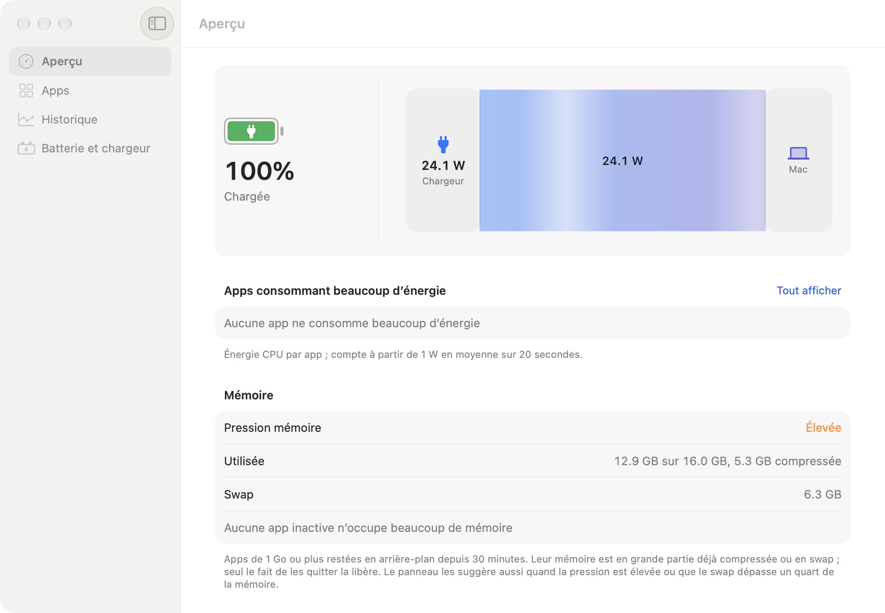

<p align="center">
  
</p>

<h1 align="center">Rill</h1>

<p align="center">
  <a href="https://github.com/chengffei/rill/releases/latest"><b>Télécharger</b></a> ·
  <a href="https://chengffei.github.io/rill/fr/">Site web</a>
</p>

<p align="center">
  <a href="README.md">English</a> ·
  <a href="README.zh-Hans.md">简体中文</a> ·
  <a href="README.zh-Hant.md">繁體中文</a> ·
  <a href="README.ja.md">日本語</a> ·
  <a href="README.ko.md">한국어</a> ·
  <b>Français</b> ·
  <a href="README.de.md">Deutsch</a> ·
  <a href="README.es.md">Español</a>
</p>

<p align="center">
  
</p>

Une app pour la barre des menus de macOS qui montre en direct où va l’énergie de votre Mac : ce que fournit le chargeur, ce que consomme le Mac, ce qui entre dans la batterie ou en sort, et quelles apps consomment le plus d’énergie.

> **État : version précoce (0.9).** Nécessite macOS 26 ou ultérieur sur un Mac avec puce Apple. Interface en English, 简体中文, 繁體中文, 日本語, 한국어, Français, Deutsch et Español.

## Installation

**Une ligne dans Terminal** (recommandé) :

```sh
curl -fsSL https://raw.githubusercontent.com/chengffei/rill/main/install.sh | bash
```

Le [script](install.sh) télécharge la dernière version, vérifie son SHA-256, sa signature de code, son identifiant de paquet et son équipe de développement, puis place Rill dans Applications. Les fichiers téléchargés ainsi ne sont pas mis en quarantaine : macOS ouvre Rill sans avertissement.

**Ou téléchargez l’image disque** depuis la [dernière version](https://github.com/chengffei/rill/releases/latest), puis faites glisser Rill dans Applications. Rill est signé mais pas notarié, donc macOS bloque le premier lancement : ouvrez-le, fermez l’avertissement, puis cliquez sur **Ouvrir quand même** dans *Réglages Système › Confidentialité et sécurité*.

Si l’icône de batterie n’apparaît pas, votre barre des menus est pleine ou un gestionnaire de barre des menus l’a masquée.

## Ce qu’il affiche

- **Barre des menus** : niveau de batterie, état de charge et, en option, la puissance en direct en watts (entrée du chargeur lorsqu’il est branché, sinon décharge de la batterie).
- **Panneau** (cliquez sur l’icône) : un schéma du flux d’énergie du chargeur et de la batterie vers le Mac ; mémoire utilisée, pression et swap ; apps consommant beaucoup d’énergie ; quand la mémoire vient à manquer, les apps inactives occupant 1 Go ou plus ; un graphique de puissance sur 10 minutes ; les mesures du chargeur et de la batterie.
- **Fenêtre** (Ouvrir le tableau de bord) : quatre pages.
  - *Aperçu* : charge, flux d’énergie, apps gourmandes en énergie, mémoire avec les apps inactives à quitter, consommation du jour.
  - *Apps* : un tableau triable de l’énergie, du CPU et de la mémoire par app ou par processus. Quittez ou forcez à quitter une app, arrêtez son processus le plus actif, ou repérez les apps qui ne répondent pas.
  - *Historique* : puissance, charge et température sur 1 heure à 7 jours.
  - *Batterie et chargeur* : état, nombre de cycles, capacité, puissance nominale du chargeur et tension négociée.

La puissance est lue depuis le SMC toutes les 2 secondes ; les détails du chargeur et la capacité proviennent du registre AppleSmartBattery. L’énergie par app provient de `proc_pid_rusage`, regroupée par app responsable comme le fait Moniteur d’activité. Aucune autorisation particulière n’est nécessaire.

L’historique est conservé 30 jours dans `~/Library/Application Support/Rill/history`. Rill ne se connecte à Internet que lorsque vous choisissez **Rechercher des mises à jour…**.

## Retours

Choisissez **Signaler un problème…** dans le menu de Rill. Cela ouvre un nouveau ticket GitHub avec votre version de Rill, votre version de macOS et votre modèle de Mac déjà remplis. Vous pouvez aussi [en ouvrir un ici](https://github.com/chengffei/rill/issues/new).

## Compilation

```sh
scripts/bundle.sh --install     # builds build/Rill.app, installs it in /Applications and launches it
swift test                      # needs Xcode's toolchain: DEVELOPER_DIR=/Applications/Xcode.app/Contents/Developer
scripts/make-release.sh         # dmg, zip and checksums in dist/
```

## Licence

Rill est distribué sous licence [GPL-3.0](LICENSE). Toute contribution nécessite d’accepter le [CLA](CLA.md), qu’un bot vous demande lors de votre première pull request.
