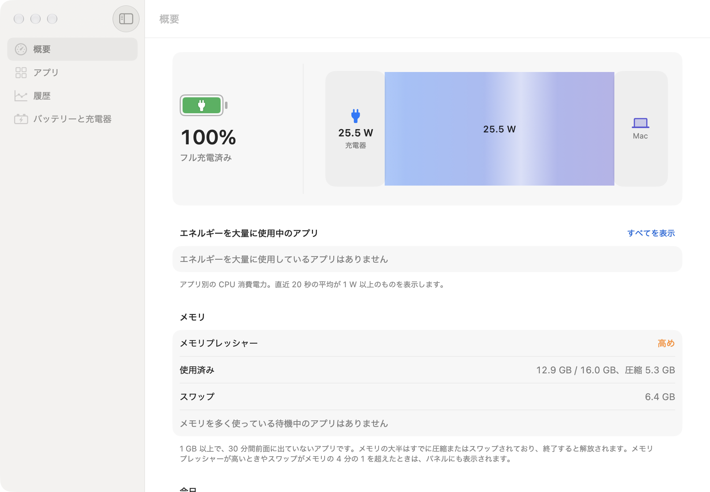

<p align="center">
  
</p>

<h1 align="center">Rill</h1>

<p align="center">
  <a href="https://github.com/chengffei/rill/releases/latest"><b>ダウンロード</b></a> ·
  <a href="https://chengffei.github.io/rill/ja/">Web サイト</a>
</p>

<p align="center">
  <a href="README.md">English</a> ·
  <a href="README.zh-Hans.md">简体中文</a> ·
  <a href="README.zh-Hant.md">繁體中文</a> ·
  <b>日本語</b> ·
  <a href="README.ko.md">한국어</a> ·
  <a href="README.fr.md">Français</a> ·
  <a href="README.de.md">Deutsch</a> ·
  <a href="README.es.md">Español</a>
</p>

<p align="center">
  
</p>

Mac の電力がどこへ流れているかをリアルタイムで表示する macOS のメニューバーアプリです。充電器から供給される電力、Mac が消費する電力、バッテリーに出入りする電力、そしてエネルギーを最も多く使っているアプリがわかります。

> **ステータス：初期段階（0.8）。** Apple シリコン搭載 Mac で macOS 26 以降が必要です。インターフェイスは English、简体中文、繁體中文、日本語、한국어、Français、Deutsch、Español に対応しています。

## インストール

**ターミナルで 1 行**（推奨）：

```sh
curl -fsSL https://raw.githubusercontent.com/chengffei/rill/main/install.sh | bash
```

この[スクリプト](install.sh)は最新リリースをダウンロードし、SHA-256、コード署名、バンドル ID、開発チームを確認してから、Rill を「アプリケーション」に配置します。この方法でダウンロードしたファイルは隔離されないため、macOS は警告なしで Rill を開きます。

**またはディスクイメージをダウンロード**：[最新リリース](https://github.com/chengffei/rill/releases/latest)から入手し、Rill を「アプリケーション」にドラッグします。Rill は署名済みですが公証されていないため、macOS は初回起動をブロックします。一度開いて警告を閉じ、*システム設定 › プライバシーとセキュリティ*で**このまま開く**をクリックしてください。

バッテリーアイコンが表示されない場合は、メニューバーがいっぱいか、メニューバー管理アプリによって隠されています。

## 表示内容

- **メニューバー**：バッテリー残量、充電状態、さらにオプションでリアルタイムのワット数（電源接続時は充電器からの入力、それ以外はバッテリーの放電）。
- **パネル**（アイコンをクリック）：充電器とバッテリーから Mac へのエネルギーフロー図、メモリの使用量・プレッシャー・スワップ、エネルギーを大量に使用中のアプリ、メモリ不足時には 1 GB 以上を保持している待機中のアプリ、10 分間の電力グラフ、充電器とバッテリーの測定値。
- **ウインドウ**（ダッシュボードを開く）：4 つのページ。
  - *概要*：充電残量、エネルギーフロー、エネルギーを多く使うアプリ、メモリと終了を検討すべき待機中のアプリ、今日の使用量。
  - *アプリ*：アプリ別またはプロセス別のエネルギー、CPU、メモリを並べ替え可能な表で表示。アプリの終了や強制終了、最も負荷の高いプロセスの終了、応答のないアプリの発見ができます。
  - *履歴*：1 時間から 7 日間の電力、充電残量、温度。
  - *バッテリーと充電器*：状態、充放電回数、容量、充電器の定格出力、ネゴシエートされた電圧。

電力は 2 秒ごとに SMC から読み取り、充電器の詳細と容量は AppleSmartBattery レジストリから取得します。アプリ別のエネルギーは `proc_pid_rusage` から取得し、アクティビティモニタと同じように責任元のアプリごとにまとめます。特別な権限は必要ありません。

履歴は `~/Library/Application Support/Rill/history` に 30 日間保存されます。Rill がネットワークに接続するのは、**アップデートを確認…**を選んだときだけです。

## フィードバック

Rill のメニューで**問題を報告…**を選びます。Rill のバージョン、macOS のバージョン、Mac のモデルが記入された新しい GitHub issue が開きます。または[こちらから作成](https://github.com/chengffei/rill/issues/new)してください。

## ビルド

```sh
scripts/bundle.sh --install     # builds build/Rill.app, installs it in /Applications and launches it
swift test                      # needs Xcode's toolchain: DEVELOPER_DIR=/Applications/Xcode.app/Contents/Developer
scripts/make-release.sh         # dmg, zip and checksums in dist/
```

## ライセンス

Rill は [GPL-3.0](LICENSE) でライセンスされています。コントリビュートには [CLA](CLA.md) への同意が必要で、最初のプルリクエストでボットが確認を求めます。
