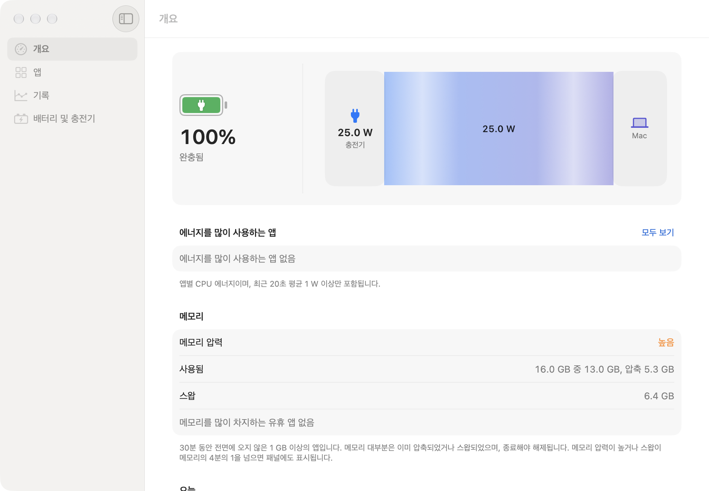

<p align="center">
  
</p>

<h1 align="center">Rill</h1>

<p align="center">
  <a href="https://github.com/chengffei/rill/releases/latest"><b>다운로드</b></a> ·
  <a href="https://chengffei.github.io/rill/ko/">웹사이트</a>
</p>

<p align="center">
  <a href="README.md">English</a> ·
  <a href="README.zh-Hans.md">简体中文</a> ·
  <a href="README.zh-Hant.md">繁體中文</a> ·
  <a href="README.ja.md">日本語</a> ·
  <b>한국어</b> ·
  <a href="README.fr.md">Français</a> ·
  <a href="README.de.md">Deutsch</a> ·
  <a href="README.es.md">Español</a>
</p>

<p align="center">
  
</p>

Mac의 전력이 어디로 가는지 실시간으로 보여 주는 macOS 메뉴 막대 앱입니다. 충전기가 공급하는 전력, Mac이 소비하는 전력, 배터리로 들어가거나 나오는 전력, 그리고 에너지를 가장 많이 사용하는 앱을 확인할 수 있습니다.

> **상태: 초기 단계(0.8).** Apple 실리콘 Mac에서 macOS 26 이상이 필요합니다. 인터페이스는 English, 简体中文, 繁體中文, 日本語, 한국어, Français, Deutsch, Español을 지원합니다.

## 설치

**터미널에서 한 줄로**(권장):

```sh
curl -fsSL https://raw.githubusercontent.com/chengffei/rill/main/install.sh | bash
```

이 [스크립트](install.sh)는 최신 릴리스를 다운로드하고 SHA-256, 코드 서명, 번들 ID, 개발자 팀을 확인한 다음 Rill을 응용 프로그램 폴더에 넣습니다. 이 방법으로 받은 파일은 격리되지 않으므로 macOS가 경고 없이 Rill을 엽니다.

**또는 디스크 이미지를 다운로드**: [최신 릴리스](https://github.com/chengffei/rill/releases/latest)에서 받은 다음 Rill을 응용 프로그램 폴더로 드래그합니다. Rill은 서명되어 있지만 공증되지 않았기 때문에 macOS가 처음 실행을 차단합니다. 앱을 열고 경고를 닫은 다음 *시스템 설정 › 개인정보 보호 및 보안*에서 **그래도 열기**를 클릭하십시오.

배터리 아이콘이 나타나지 않으면 메뉴 막대가 가득 찼거나 메뉴 막대 관리 앱이 아이콘을 숨긴 것입니다.

## 표시 항목

- **메뉴 막대**: 배터리 잔량, 충전 상태, 그리고 선택적으로 실시간 와트(전원 연결 시 충전기 입력, 그 외에는 배터리 방전).
- **패널**(아이콘 클릭): 충전기와 배터리에서 Mac으로 흐르는 에너지 흐름도, 사용 중인 메모리·메모리 압력·스왑, 에너지를 많이 사용하는 앱, 메모리가 부족할 때 1 GB 이상을 차지하는 유휴 앱, 10분 전력 차트, 충전기 및 배터리 측정값.
- **윈도우**(대시보드 열기): 4개의 페이지.
  - *개요*: 충전량, 에너지 흐름, 에너지를 많이 쓰는 앱, 메모리 및 종료할 만한 유휴 앱, 오늘 사용량.
  - *앱*: 앱별 또는 프로세스별 에너지, CPU, 메모리를 정렬 가능한 표로 표시. 앱을 종료하거나 강제 종료하고, 가장 바쁜 프로세스를 끝내고, 응답 없는 앱을 찾을 수 있습니다.
  - *기록*: 1시간부터 7일까지의 전력, 충전량, 온도.
  - *배터리 및 충전기*: 성능 상태, 사이클 수, 용량, 충전기 정격 출력, 협상된 전압.

전력은 2초마다 SMC에서 읽고, 충전기 세부 정보와 용량은 AppleSmartBattery 레지스트리에서 가져옵니다. 앱별 에너지는 `proc_pid_rusage`에서 가져오며, 활성 상태 보기와 같은 방식으로 책임 앱별로 묶습니다. 특별한 권한은 필요하지 않습니다.

기록은 `~/Library/Application Support/Rill/history`에 30일 동안 보관됩니다. Rill은 **업데이트 확인…**을 선택할 때만 인터넷에 연결합니다.

## 피드백

Rill 메뉴에서 **문제 보고…**를 선택하십시오. Rill 버전, macOS 버전, Mac 모델이 채워진 새 GitHub issue가 열립니다. 또는 [여기에서 작성](https://github.com/chengffei/rill/issues/new)할 수 있습니다.

## 빌드

```sh
scripts/bundle.sh --install     # builds build/Rill.app, installs it in /Applications and launches it
swift test                      # needs Xcode's toolchain: DEVELOPER_DIR=/Applications/Xcode.app/Contents/Developer
scripts/make-release.sh         # dmg, zip and checksums in dist/
```

## 라이선스

Rill은 [GPL-3.0](LICENSE) 라이선스를 따릅니다. 기여하려면 [CLA](CLA.md)에 동의해야 하며, 첫 pull request에서 봇이 동의를 요청합니다.
