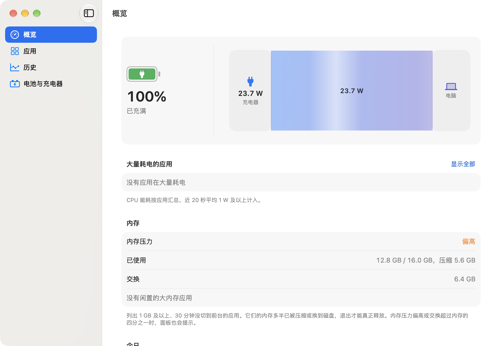

<p align="center">
  
</p>

<h1 align="center">Rill</h1>

<p align="center">
  <a href="https://github.com/chengffei/rill/releases/latest"><b>下载</b></a> ·
  <a href="https://chengffei.github.io/rill/zh/">官网</a>
</p>

<p align="center">
  <a href="README.md">English</a> ·
  <b>简体中文</b> ·
  <a href="README.zh-Hant.md">繁體中文</a> ·
  <a href="README.ja.md">日本語</a> ·
  <a href="README.ko.md">한국어</a> ·
  <a href="README.fr.md">Français</a> ·
  <a href="README.de.md">Deutsch</a> ·
  <a href="README.es.md">Español</a>
</p>

<p align="center">
  
</p>

一个 macOS 菜单栏应用，实时显示 Mac 的电都去了哪里：充电器送进多少，Mac 用掉多少，电池充入或放出多少，以及哪些应用最耗电。

> **状态：早期（0.9）。** 需要 Apple 芯片、macOS 26 或更高版本。界面支持 English、简体中文、繁體中文、日本語、한국어、Français、Deutsch 和 Español。

## 安装

**在终端里运行一行命令**（推荐）：

```sh
curl -fsSL https://raw.githubusercontent.com/chengffei/rill/main/install.sh | bash
```

这个[脚本](install.sh)会下载最新版本，校验 SHA-256、代码签名、Bundle ID 和开发者团队，然后把 Rill 放进“应用程序”。这样下载的文件不会被隔离，macOS 打开 Rill 时不会弹出警告。

**也可以下载磁盘映像**：从[最新版本](https://github.com/chengffei/rill/releases/latest)下载，再把 Rill 拖进“应用程序”。Rill 已签名但未经公证，所以 macOS 会拦下首次启动：先打开它，关掉警告，再到*系统设置 › 隐私与安全性*里点**仍要打开**。

如果菜单栏上没有出现电池图标，说明菜单栏已满，或者被菜单栏管理工具隐藏了。

## 显示内容

- **菜单栏**：电量、充电状态，还可以显示实时瓦数（接上电源时是充电器输入，否则是电池放电）。
- **面板**（点击图标）：从充电器和电池流向 Mac 的能量流图；已用内存、内存压力和交换；大量耗电的应用；内存紧张时，占用 1 GB 以上的闲置应用；10 分钟功率图；充电器和电池读数。
- **窗口**（打开 Dashboard）：四个页面。
  - *概览*：电量、能量流、耗电应用、内存及值得退出的闲置应用、今日用量。
  - *应用*：按应用或按进程列出能耗、CPU 和内存的表格，可排序。可以退出或强制退出应用，结束它最忙的进程，或找出未响应的应用。
  - *历史*：1 小时到 7 天的功率、电量和温度。
  - *电池与充电器*：健康度、循环次数、容量、充电器额定功率和协商电压。

功率每 2 秒从 SMC 读取一次；充电器信息和容量来自 AppleSmartBattery 注册表。各应用能耗来自 `proc_pid_rusage`，按责任应用归组，和“活动监视器”的做法一样。不需要任何特殊权限。

历史记录保留 30 天，存放在 `~/Library/Application Support/Rill/history`。只有你选择**检查更新…**时，Rill 才会联网。

## 反馈

在 Rill 的菜单里选择**报告问题…**。它会新建一个 GitHub issue，自动填好 Rill 版本、macOS 版本和 Mac 机型。也可以[在这里新建](https://github.com/chengffei/rill/issues/new)。

## 构建

```sh
scripts/bundle.sh --install     # builds build/Rill.app, installs it in /Applications and launches it
swift test                      # needs Xcode's toolchain: DEVELOPER_DIR=/Applications/Xcode.app/Contents/Developer
scripts/make-release.sh         # dmg, zip and checksums in dist/
```

## 许可证

Rill 采用 [GPL-3.0](LICENSE) 许可证。贡献代码需要同意 [CLA](CLA.md)，你第一次提交 pull request 时会有机器人请你确认。
