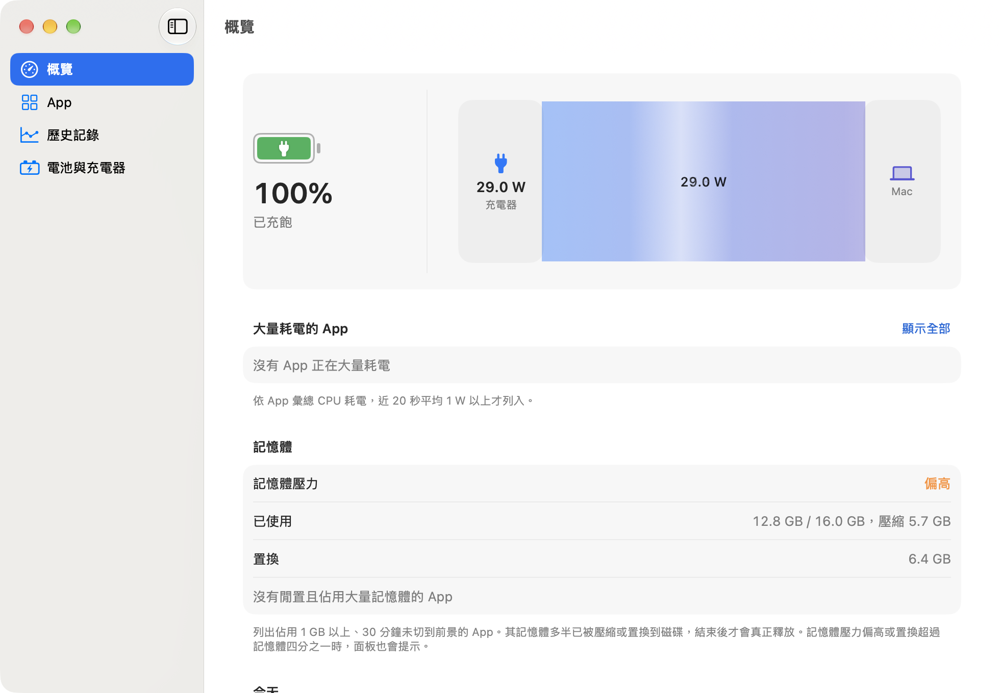

<p align="center">
  
</p>

<h1 align="center">Rill</h1>

<p align="center">
  <a href="https://github.com/chengffei/rill/releases/latest"><b>下載</b></a> ·
  <a href="https://chengffei.github.io/rill/zh-hant/">官方網站</a>
</p>

<p align="center">
  <a href="README.md">English</a> ·
  <a href="README.zh-Hans.md">简体中文</a> ·
  <b>繁體中文</b> ·
  <a href="README.ja.md">日本語</a> ·
  <a href="README.ko.md">한국어</a> ·
  <a href="README.fr.md">Français</a> ·
  <a href="README.de.md">Deutsch</a> ·
  <a href="README.es.md">Español</a>
</p>

<p align="center">
  
</p>

一個 macOS 選單列 App，即時顯示 Mac 的電力流向：充電器送進多少、Mac 用掉多少、電池充入或放出多少，以及哪些 App 最耗電。

> **狀態：早期（0.8）。** 需要 Apple 晶片、macOS 26 或以上版本。介面支援 English、简体中文、繁體中文、日本語、한국어、Français、Deutsch 和 Español。

## 安裝

**在終端機執行一行指令**（建議）：

```sh
curl -fsSL https://raw.githubusercontent.com/chengffei/rill/main/install.sh | bash
```

這個[指令碼](install.sh)會下載最新版本，驗證 SHA-256、程式碼簽署、Bundle ID 和開發者團隊，然後把 Rill 放進「應用程式」。用這種方式下載的檔案不會被隔離，因此 macOS 開啟 Rill 時不會跳出警告。

**或下載磁碟映像檔**：從[最新版本](https://github.com/chengffei/rill/releases/latest)下載，再把 Rill 拖進「應用程式」。Rill 已簽署但未經公證，所以 macOS 會擋下第一次啟動：先打開它，關閉警告，再到*系統設定 › 隱私權與安全性*按一下**強制打開**。

如果選單列沒有出現電池圖像，表示選單列已滿，或被選單列管理工具隱藏了。

## 顯示內容

- **選單列**：電量、充電狀態，也可以顯示即時瓦數（接上電源時是充電器輸入，否則是電池放電）。
- **面板**（按一下圖像）：從充電器和電池流向 Mac 的能量流向圖；已用記憶體、記憶體壓力和置換；大量耗電的 App；記憶體吃緊時，佔用 1 GB 以上的閒置 App；10 分鐘功率圖；充電器和電池讀數。
- **視窗**（打開儀表板）：四個頁面。
  - *概覽*：電量、能量流向、耗電 App、記憶體及值得結束的閒置 App、今天的用量。
  - *App*：依 App 或依程序列出耗電、CPU 和記憶體的表格，可排序。可以結束或強制結束 App、終止它最忙碌的程序，或找出沒有回應的 App。
  - *歷史記錄*：1 小時到 7 天的功率、電量和溫度。
  - *電池與充電器*：健康度、循環次數、容量、充電器額定功率和協商電壓。

功率每 2 秒從 SMC 讀取一次；充電器資訊和容量來自 AppleSmartBattery 登錄檔。各 App 的耗電來自 `proc_pid_rusage`，依負責的 App 歸組，和「活動監視器」的做法相同。不需要任何特殊權限。

歷史記錄保留 30 天，存放在 `~/Library/Application Support/Rill/history`。只有在你選擇**檢查更新項目⋯**時，Rill 才會連網。

## 意見回饋

在 Rill 的選單中選擇**回報問題⋯**。它會開啟新的 GitHub issue，並自動填好 Rill 版本、macOS 版本和 Mac 機型。也可以[在這裡建立](https://github.com/chengffei/rill/issues/new)。

## 建置

```sh
scripts/bundle.sh --install     # builds build/Rill.app, installs it in /Applications and launches it
swift test                      # needs Xcode's toolchain: DEVELOPER_DIR=/Applications/Xcode.app/Contents/Developer
scripts/make-release.sh         # dmg, zip and checksums in dist/
```

## 授權條款

Rill 採用 [GPL-3.0](LICENSE) 授權。貢獻程式碼需要同意 [CLA](CLA.md)，你第一次提交 pull request 時會有機器人請你確認。
